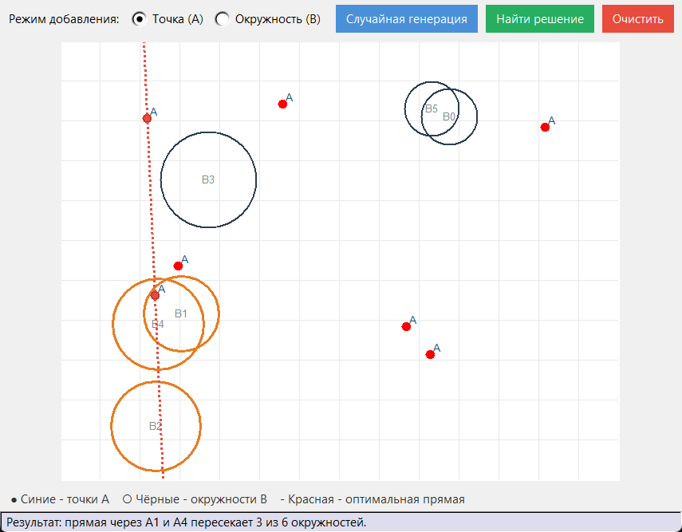

# Прямая, пересекающая больше всего окружностей

Курсовая по основам алгоритмизации и программирования (задание 18).

Задача: даны множество точек A и множество окружностей B на плоскости. Нужно найти две точки из A, прямая через которые пересекает наибольшее количество окружностей из B.



## Как работает

Программа перебирает все пары точек. Для каждой пары считается, сколько окружностей пересекает прямая через эти точки: прямая пересекает окружность, если расстояние от центра до прямой не больше радиуса. Запоминается пара с максимальным числом пересечений. Сложность O(n² · m), где n - число точек, m - число окружностей.

Интерфейс на Tkinter: точки и окружности можно ставить мышкой на холсте или сгенерировать случайно. После нажатия «Найти решение» лучшая прямая рисуется красным пунктиром, а пересечённые окружности подсвечиваются.

Блок-схема алгоритма: [images/flowchart.png](images/flowchart.png)

## Запуск

Нужен только Python 3, сторонних библиотек нет.

```
python main.py
```

---

Учебная работа, РГУ нефти и газа им. Губкина
